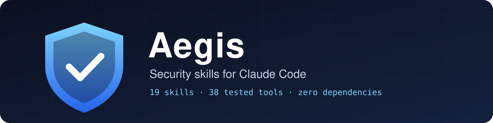

<p align="center">
  
</p>

<p align="center">
  <b>19 security skills for Claude Code. 38 tested tools. Zero dependencies.</b><br>
  Drop them in and Claude reviews your headers, cloud configs, CI pipelines, agent settings, logs and incidents like a security engineer would.
</p>

<p align="center">
  
  
  
  
  
</p>

---

## Why Aegis

Most "security prompts" are a wall of advice. Aegis skills come with real tools Claude runs for you, so answers are based on your actual files, not guesses.

- **Tools, not just text.** Every skill ships Python scripts that parse your configs, logs, certificates, manifests and pipelines and return findings with a severity, a rule id and a fix you can paste
- **Nothing to install.** Python standard library only. If you have `python3`, it works. No pip, no Docker, no API keys
- **Safe by default.** Read-only. No exploit payloads, no cracking, no evasion. Live checks only touch targets you name, with timeouts
- **Works offline and in CI.** Every tool runs on saved files, prints `--json`, and exits `1` when it finds something at or above `--fail-on`, so you can gate a pipeline on it
- **Tested.** 568 unit tests on Python 3.9 to 3.15, macOS and Linux, plus a validator that checks every skill against [one standard](docs/SKILL_STANDARD.md)

## Install

**As a Claude Code plugin** (easiest, updates with one command):

```
/plugin marketplace add arthuryuzbashev/aegis-skills
/plugin install aegis@aegis-skills
```

**Or with the install script:**

```bash
git clone https://github.com/arthuryuzbashev/aegis-skills.git
cd aegis-skills
./install.sh                 # every skill, for all your projects (~/.claude/skills)
./install.sh --link          # symlink instead, so `git pull` updates them
./install.sh web-appsec cloud-iac   # just the ones you want
./install.sh --project ~/code/myapp # one project only
./install.sh --list          # see what's available
./install.sh --uninstall     # remove them again
```

Restart Claude Code and just ask. Claude picks the right skill from what you say.

## Try it

```
> audit the security headers on https://staging.myapp.dev
> is my .claude/settings.json safe? also check .mcp.json
> scan this repo for leaked secrets before I make it public
> review .github/workflows for supply chain problems
> here's an auth.log, did someone get in?
> score this CVSS vector and tell me what to patch first: AV:N/AC:L/PR:N/UI:N/S:U/C:H/I:H/A:H
> threat model our checkout service, the design is in docs/architecture.md
> we think we got ransomware on a Windows box, what do we do first?
```

The tools also run on their own:

```console
$ python3 skills/web-appsec/scripts/header_audit.py --file skills/web-appsec/examples/weak_headers.txt
Header audit: skills/web-appsec/examples/weak_headers.txt (HTTP 200)
Score 0/100, grade F, 12 finding(s)

[HIGH    ] HDR-001  Strict-Transport-Security missing
           Browsers can be downgraded to plain HTTP on the first visit or a hostile network.
           fix: Strict-Transport-Security: max-age=31536000; includeSubDomains
[HIGH    ] HDR-040  CORS wildcard with credentials
           ...
```

## The skills

### Build and ship securely

| Skill | What Claude does with it | Tools |
|---|---|---|
| [web-appsec](skills/web-appsec/) | Grades security headers, cookies and CORS, audits JWTs, reviews code against the OWASP Top 10 | `header_audit.py` `jwt_inspect.py` |
| [code-secrets-review](skills/code-secrets-review/) | Finds leaked keys and tokens (masked) and risky code patterns across Python, JS/TS, PHP and Go, each with a CWE | `secret_scan.py` `sast_lite.py` |
| [supply-chain](skills/supply-chain/) | Audits GitHub Actions (unpinned actions, script injection, `pull_request_target`), catches typosquats and dependency confusion | `ci_audit.py` `typosquat_check.py` |
| [vuln-triage](skills/vuln-triage/) | Exact CVSS v3.1 scoring, dependency audits for pip and npm with OSV, and a patch-first priority list | `cvss_calc.py` `dep_audit.py` |
| [cloud-iac](skills/cloud-iac/) | Scans Terraform, Kubernetes, Dockerfiles and compose files, and finds privilege escalation paths in AWS IAM policies | `iac_scan.py` `iam_policy_audit.py` |
| [ai-agent-security](skills/ai-agent-security/) | Hardens Claude Code, Cursor and MCP configs, and scans content for prompt injection (hidden text, Unicode tricks, exfil links) | `agent_config_audit.py` `prompt_injection_scan.py` |
| [mobile-appsec](skills/mobile-appsec/) | Reviews AndroidManifest and iOS Info.plist / entitlements against OWASP MASVS | `android_manifest_audit.py` `ios_plist_audit.py` |
| [crypto-tls](skills/crypto-tls/) | Grades TLS endpoints and certificates, finds crypto misuse in code, identifies hash formats | `tls_check.py` `crypto_review.py` |
| [threat-modeling](skills/threat-modeling/) | Turns a system description into STRIDE threats and a Mermaid diagram, and diffs two designs for new risks | `stride_model.py` `model_diff.py` |

### Defend and detect

| Skill | What Claude does with it | Tools |
|---|---|---|
| [host-hardening](skills/host-hardening/) | Read-only Linux and macOS baseline audits: SSH, sysctl, SUID, accounts, FileVault, SIP, firewall | `linux_audit.py` `macos_audit.py` |
| [security-recon](skills/security-recon/) | Checks SPF, DKIM, DMARC and MTA-STS, maps your attack surface and flags dangling DNS | `email_auth_audit.py` `surface_map.py` |
| [log-analysis](skills/log-analysis/) | Triages auth, web and JSON logs for brute force, spraying, scanners and injection, and writes SIEM queries for Splunk, KQL and Elastic | `log_triage.py` `query_translate.py` |
| [detection-engineering](skills/detection-engineering/) | Lints Sigma rules and unit-tests them against sample events, no SIEM needed | `sigma_lint.py` `detection_test.py` |
| [threat-hunting](skills/threat-hunting/) | Extracts and defangs IOCs, maps behaviour to MITRE ATT&CK and exports a Navigator layer | `ioc_extract.py` `attack_mapper.py` |

### Respond and investigate

| Skill | What Claude does with it | Tools |
|---|---|---|
| [incident-response](skills/incident-response/) | Step-by-step triage plans for 8 incident types on Linux, macOS and Windows, plus one merged UTC timeline from all your logs | `triage_plan.py` `timeline_build.py` |
| [malware-triage](skills/malware-triage/) | Safe static triage of suspicious files (PE, ELF, Mach-O, Office, PDF) without ever running them, and draft YARA rules | `file_triage.py` `yara_draft.py` |
| [network-forensics](skills/network-forensics/) | Reads pcap/pcapng in pure Python (DNS, HTTP, TLS SNI) and finds beaconing in Zeek or flow logs | `pcap_summary.py` `beacon_detect.py` |

### Test and govern

| Skill | What Claude does with it | Tools |
|---|---|---|
| [pentest-engagement](skills/pentest-engagement/) | Keeps authorized tests in scope (IPs, domains, exclusions, test window) and turns findings into a clean client report | `scope_check.py` `findings_report.py` |
| [grc-compliance](skills/grc-compliance/) | Scores a risk register with heat maps and maps your controls to NIST CSF 2.0, ISO 27001:2022 and SOC 2 | `risk_register.py` `control_gap.py` |

## How a skill is built

```
skills/web-appsec/
├── SKILL.md          when to use it, ground rules, workflow, tools, report format
├── scripts/          the tools Claude runs (stdlib Python, --json, exit codes)
├── references/       checklists and cheat sheets Claude opens when needed
└── examples/         realistic sample inputs to try every tool on
```

Every tool follows the same rules: findings carry an `id`, `severity`, `title`, `detail` and `fix`; `--json` for machines; exit `0` clean, `1` findings at or above `--fail-on`, `2` bad input; secrets are always masked. The full contract is in [docs/SKILL_STANDARD.md](docs/SKILL_STANDARD.md).

### Use a tool in CI

```yaml
- name: Workflow security
  run: python3 aegis-skills/skills/supply-chain/scripts/ci_audit.py .github/workflows --fail-on high
- name: Leaked secrets
  run: python3 aegis-skills/skills/code-secrets-review/scripts/secret_scan.py . --fail-on high
```

## Development

```bash
make check                          # validator + all tests
python3 tools/validate.py web-appsec  # check one skill against the standard
python3 -m unittest discover -s tests -v
```

New skills and checks are welcome, see [CONTRIBUTING.md](CONTRIBUTING.md).

## Responsible use

Aegis is for defenders, builders and authorized testers. Point live checks only at systems you own or have written permission to test. The tools are read-only and never exploit anything, but findings describe weak spots, so treat reports as sensitive. See [SECURITY.md](SECURITY.md).

Pattern-based tools miss things and flag things. A clean run lowers risk, it does not prove safety.

## License

[MIT](LICENSE)
